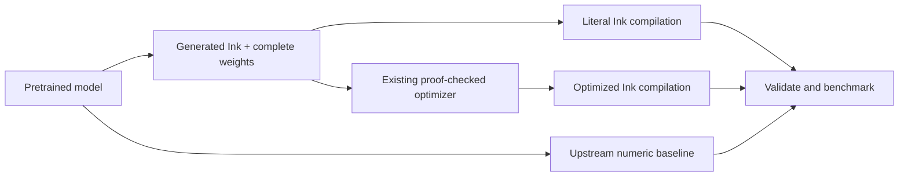

# Neural → Ink

Convert a pretrained embedding model into ordinary Ink source and weight data,
compile it with **unchanged Ink**, and measure whether checked optimization helps.

The first supported architecture is normalized **Model2Vec static embeddings**.
The retained experiment uses Minish Lab's real pretrained **Potion 2M** model:
29,528 vocabulary entries × 64 dimensions, or 1,889,792 learned F32 values.
This is lookup, mean pooling and L2 normalization. Transformer/LLM import and
discovery of hidden symbolic algorithms are future work.

**Initial result:** conversion and fidelity checks pass, but this workload shows
no clear compiler-optimization speedup. The original NumPy kernel is faster than
the compiled JavaScript implementation. The later [Rust/GPU experiment](results/targets/REPORT.md)
finds a throughput benefit from large GPU batches, against a CPU baseline.
See [the initial measured report](results/REPORT.md)
and [raw evidence](results/report.json). Adverse results are part of the experiment.



## What is converted

`src/neural_to_ink/converter.py` reads the model's config and safetensors.
It emits [readable Ink](generated/model.ink), a little-endian F32 weight asset,
and a [hash/shape manifest](generated/model.json). All numeric inference runs
inside the generated Ink program; there is no Python model call inside Ink.
The original pinned tokenizer remains a host-side dependency and is identical
across comparisons. Inputs are valid tokenizer IDs in the model's vocabulary.
No model training, vocabulary reduction or dimensional truncation is performed.

The complete weight table is captured once through Ink's existing sealed-value
interfaces. Two argument shards keep each capture within its existing one-million
node bound. A normal bounded Ink loop constructs the coordinate list, avoiding
an existing planner nesting limit for long literal lists. Neither mechanism
changes Ink or its limits. Unsupported architectures/shapes fail explicitly.

The importer defines explicit source-order binary32 arithmetic. Pooling is a
left fold; the norm's squared terms use a right fold. NumPy uses its own reduction
strategy, so equivalence to the original model is checked with stated tolerance,
not claimed bitwise. Literal and optimized Ink outputs must match bitwise,
and both must match a separate ordered F32 oracle bitwise. This importer is an
architecture translation, not a mechanistic decompiler.

## Reproduce

Requirements: Python 3.12+, uv, Node 22+, and the pinned Ink distribution.
Rust/Cargo are needed only when building that compiler yourself.

```sh
uv sync --dev
uv run python scripts/prepare_model.py
# Start from a recursive ink-lang checkout at the revision in toolchain.lock.json.
# Build it normally with cargo build --release --locked, without source patches.
uv run python scripts/bootstrap_toolchain.py /absolute/path/to/ink-lang
uv run python scripts/build.py --toolchain work/toolchain
INK="$PWD/work/toolchain/ink" uv run pytest -q
uv run python scripts/benchmark.py --processes 6 --rounds 9
```

Bootstrap copies only committed planner/knowledge tool bytes and the existing
compiler into a private directory. It verifies pinned package revisions.
The compiler's standard modules are embedded; the initial experiment uses its
JavaScript target. A small vendored selection of existing Ink laws is published into
the experiment's private catalogue. Existing untrusted producers may propose
additional laws, and the unchanged compiler checks every selected application.
No installed/global knowledge database is written. The retained selection fuses
the norm's map into its ordered reduction; it does not change floating-point
grouping. The source-order pooling loop currently remains unchanged.

For an already-downloaded compatible model:

```sh
uv run neural-to-ink /path/to/model build --model-id OWNER/MODEL --revision COMMIT
```

Only the documented normalized, unquantized two-shard Model2Vec domain is
supported. Merely changing the model identifier does not import a transformer.

## Measurement boundaries

Three warm numeric paths receive the **same token IDs** and return complete
64-dimensional embeddings: upstream Model2Vec/NumPy, literal Ink/Node, and
checked-optimized Ink/Node. Weight capture is paid once per fresh process.
The compiler comparison uses identical runtime, corpus and call boundaries.
Python/NumPy versus JavaScript is an implementation comparison, not an isolated
compiler effect. This initial report covers CPU JavaScript; the follow-up below
measures native Rust and actual GPU execution separately.

Six process groups alternate execution order. Each process warms three complete
corpus passes, then records nine passes over 64 cases. Cases include empty and
Unicode text, repeated tokens, text truncated at 512 tokens and seeded IDs from
the full vocabulary. Timed calls receive changing queries; only weights are
bound, so whole predictions cannot be retained between calls. Every output is
consumed. All raw outputs and timings are retained, not just the fastest sample.

The harness also records full-library text-batch timings, setup/import/capture,
process peak RSS, compilation/search time and artifact sizes. Full-library text
timings include tokenization and are not compared directly with numeric-only
Ink timing. Correctness checking is separate from timed passes. Twelve distinct
text fixtures additionally check nearest-neighbor ranking preservation; this is
not an embedding-quality benchmark such as MTEB.

`artifacts/` retains the core, generated target modules and portable selection.
`results/` binds their compiler/source identities and records harness hashes.
Model weights are redownloaded from an immutable revision and hash-checked.
No credentials or model caches are committed.

## Boundaries and next steps

This experiment establishes a full small-model conversion and checked optimization
attempt. It does not demonstrate a speedup, general network import, neural
architecture discovery, or a universal proof of the compiler/importer.
Next useful work is wider operator coverage and
external source-bound laws for ordered pooling, followed by measurements under
the same explicit boundaries. Ink remains an independently pinned dependency.

## Native Rust and GPU follow-up

The first benchmark was entirely CPU: upstream NumPy versus compiled Node.js.
The [follow-up report](results/targets/REPORT.md) adds native Rust and the actual
Apple M4 Pro GPU through Metal. It requires `gpu-required`, checks a physical
adapter, and validates every returned embedding against the independent F32 oracle.
There is **no upstream GPU baseline** here. A CPU-to-GPU gain does not establish
that Ink outperforms another GPU implementation of the model.

Target preparation is explicit source-level importer work, not a new optimizer
law or compiler modification. A balanced constant coordinate list avoids the
original GPU fallback. Three batch entrypoints expose independent pooling,
normalization and output coordinates to the GPU. Native variants use existing
owned buffers within one pure invocation to avoid cloning the complete weight
table at every helper call. The original helper-heavy native probe and a slower
row-oriented variant are retained rather than omitted.

Rust/Cargo must be on PATH, alongside the requirements above:

```sh
uv run python scripts/build_targets.py --toolchain work/toolchain
uv run python scripts/target_benchmark.py --processes 3
```

Native timings include model copy-in once per batch through its current typed
API. GPU timings keep weights resident and include upload of new query data,
three completed dispatches, readback and decoded output. Session open/model upload
is separate and recorded. Large-batch per-embedding values describe amortized
throughput, not individual request latency. The GPU still loses on small batches.
The supplied shaders preserve Ink's strict ordered binary32 contract using
integer-lane arithmetic; they are not ML-specific fast-math kernels.

## Browser WebGPU

The [browser report](results/browser/REPORT.md) measures installed, visible Chrome
with three fresh browser process groups on the same Mac. The unchanged compiler's
browser runtime executes the same three GPU stages with resident weights.
Every output in every measured round matches the ordered F32 oracle bit for bit.
CPU fallback is forbidden. A warm single request takes about 0.71 ms; a batch of
1,024 takes about 4.20 ms total, or 4.10 µs per embedding. These are numeric
inference timings: input uploads, completed GPU work and complete decoded
readback are included; tokenization, model download and startup are excluded.

After building the targets above, install the benchmark-only browser dependency
in the ignored work directory and use an installed Google Chrome:

```sh
npm install --prefix work/browser-tools playwright@1.58.2 --no-audit --no-fund
PLAYWRIGHT_MODULE=../work/browser-tools/node_modules/playwright/index.mjs node scripts/browser_benchmark.mjs
```

The harness serves only on loopback, uses isolated browser profiles, checks for a
hardware adapter and closes its browsers/server afterwards. The retained report
includes the browser version, GPU adapter information, startup costs, raw round
timings and output hashes. No upstream browser GPU implementation is benchmarked.

MIT. Model and dependency provenance: [THIRD_PARTY.md](THIRD_PARTY.md).
