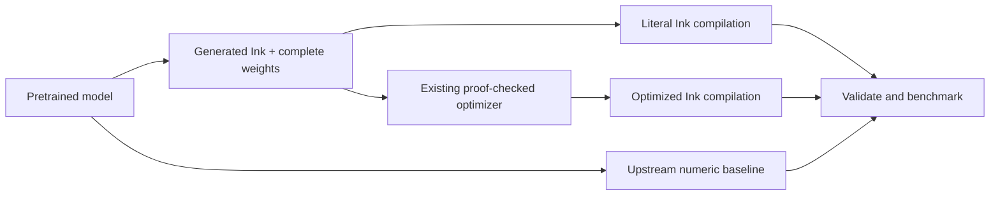

# Ink Static Embeddings

Import static embedding inference into readable Ink, retain learned weights as
data, and benchmark JavaScript, Rust and WebGPU execution. The tokenizer remains
host-side. This is an architecture-aware importer, not a decompiler that recovers
algorithms or concepts from learned weights.

The supported architecture is **static token embeddings with mean pooling and
optional L2 normalization**. The importer reads model metadata and weights;
there is no model-name allowlist. It supports Model2Vec and Sentence Transformers
StaticEmbedding exports. Tokenization stays host-side; generated numeric
inference runs independently of the original library. Transformer/LLM import and
discovery of hidden symbolic algorithms are future work.

## Tested models

**Three pretrained models and two synthetic fixtures** have passed JavaScript,
Rust and hardware WebGPU correctness checks:

| Pretrained model | Dimensions | F32 table values | Correctness | Performance data |
| --- | ---: | ---: | --- | --- |
| [minishlab/potion-base-2M](https://huggingface.co/minishlab/potion-base-2M) | 64 | 1,889,792 | JS / Rust / WebGPU | [CPU](results/compiler/REPORT.md), [native GPU](results/targets/REPORT.md), [browser WebGPU](results/browser/REPORT.md) |
| [minishlab/potion-base-8M](https://huggingface.co/minishlab/potion-base-8M) | 256 | 7,559,168 | JS / Rust / WebGPU | Not benchmarked |
| [sentence-transformers/static-retrieval-mrl-en-v1](https://huggingface.co/sentence-transformers/static-retrieval-mrl-en-v1) | 1,024 | 31,254,528 | JS / Rust / WebGPU | Not benchmarked |

The synthetic fixtures cover weighted/remapped 7-dimensional embeddings and
5-dimensional embeddings with clamped normalization. They are test data, not
pretrained models. See [all tested models, pinned revisions and evidence](TESTED_MODELS.md)
and the [general architecture validation](results/general/REPORT.md).

Performance claims currently apply **only to Potion 2M**. Correctness results for
the other models do not establish their speed or embedding quality.

## Results

**Initial result:** conversion and fidelity checks pass, but this workload shows
no clear compiler-optimization speedup. The original NumPy kernel is faster than
the compiled JavaScript implementation. The later [Rust/GPU experiment](results/targets/REPORT.md)
finds a throughput benefit from large GPU batches, against a CPU baseline.
See [the initial measured report](results/REPORT.md)
and [raw evidence](results/report.json). Adverse results are part of the experiment.

The [checked compiler follow-up](results/compiler/REPORT.md) makes the existing
ordered pooling fusion reachable and fixes its structural search price. The same
unchanged model source now runs **1.70× faster in JavaScript** than the prior
checked result (32.18 → 18.94 µs/embedding). Rust with a checked borrowed
entrypoint averages 10.97 µs over the same mixed corpus. Both CPU results remain
slower than the historical NumPy 8.51 µs baseline. These are CPU improvements;
GPU gains are recorded separately.



## Import and run a static model

Requirements: Python 3.12+, uv, Node 22+, the pinned Ink toolchain and Rust/Cargo
on PATH for the Rust and WebGPU builds. Bootstrap the toolchain as described
below. The default CLI emits schema 2 metadata and a complete F32 table:

```sh
uv sync --dev
# With the distribution at toolchain.lock.json, built using cargo build --release --locked:
uv run python scripts/bootstrap_toolchain.py /absolute/path/to/ink-lang
uv run ink-static-embeddings /path/to/model build/my-model --model-id OWNER/MODEL --revision COMMIT
uv run python scripts/build_model.py --build build/my-model --toolchain work/toolchain
# Add --optimize to also run the existing proof-checked JavaScript optimizer.
```

Use `--format model2vec` or `--format sentence-transformers` to override format
detection. `--targets javascript,rust,webgpu` selects targets; its default builds
all three. This generates a literal JS module, a Rust crate with `native_batch`,
and a browser/native WebGPU bundle. Rust can be compiled with ordinary Cargo.

The importer derives dimensions, vocabulary and the number of JavaScript weight
shards from metadata. Shards stay below Ink's capture-node limit. Rust uses an
owned flat buffer within a pure batch call; WebGPU uses a resident flat table.
Neither target depends on a Potion-specific split or dimension count.

Model2Vec exports may include F32 per-token weights and vocabulary mappings.
These are materialized into the effective lookup table, preserving F32 row
multiplication before pooling. Source file hashes and this expansion are recorded.
Normalization is preserved: Model2Vec uses norm plus epsilon, while the optional
Sentence Transformers Normalize module clamps the norm. Raw means are supported
too. Unknown-token filtering follows the source format.

For browser numeric inference, serve the model directory and this repo's host
module over HTTP(S), then use pretokenized IDs from the original tokenizer:

```js
import {loadStaticEmbedding} from '/runtime/static-embedding.mjs';
const model = await loadStaticEmbedding('/build/my-model/', {backend: 'gpu'});
const session = await model.createSession({batchSize: 2, tokenCapacity: 32});
const embeddings = await session.encodeBatch([[1, 2, 3], [4, 5]]);
await session.close();
await model.close();
```

IDs in this example must exist in the imported vocabulary. A session keeps weights
resident and accepts changing queries within its declared capacities. JavaScript
uses `loadStaticEmbedding(base, {backend: 'javascript'})` and `encodeBatch(queries)`;
Node can use the exported `createJavascriptEncoder` with a generated module,
manifest and F32 table. Encoders return flat F32 embeddings in document order.
Inputs outside the vocabulary or session limits fail rather than being truncated.

Current boundaries: finite F32 tables, 1..4096 dimensions, mean pooling, and optional
supported normalization. Integer/packed quantized tables, extra Dense/attention
layers and other pooling operations are rejected. GPU limits remain Ink's existing
256 MiB live-allocation budget plus the actual device limits. Larger models can
be imported for CPU targets without fitting the GPU budget; vocabulary expansion
may increase their effective table size. GPU sessions default to at most 4096
tokens per document; `build_model.py --max-tokens N` changes the explicit bound.

To reproduce the validation matrix (PyTorch is only a validation dependency):

```sh
uv sync --dev --group validation
uv run python scripts/prepare_validation_models.py
# For each NAME: potion-2m, potion-8m, st-retrieval, unseen-weighted, unseen-clamp
uv run python scripts/build_model.py --build build/general/NAME
uv run --group validation python scripts/validate_model.py --model-dir work/models/NAME --build build/general/NAME --rust
npm install --prefix work/browser-tools playwright@1.58.2 --no-audit --no-fund
PLAYWRIGHT_MODULE=../work/browser-tools/node_modules/playwright/index.mjs node scripts/validate_browser.mjs build/general/NAME
INK="$PWD/work/toolchain/ink" uv run pytest -q
```

The general validation checks original Model2Vec inference or PyTorch's actual
StaticEmbedding operations with tolerance, then demands bit-exact agreement with
the independent ordered F32 oracle across generated JavaScript, Rust and hardware
WebGPU. These checks establish tested compatibility, not a universal proof for all
possible models or a new performance claim.

## Historical Potion 2M experiment

The sections below retain the original schema 1 benchmark and its reproduction
scripts. `prepare_model.py` explicitly selects that historical importer. Its
measured results do not apply automatically to other models or the new layouts.
Use `toolchain.legacy.lock.json` for this historical reproduction.

## What is converted

`src/ink_static_embeddings/converter.py` reads the model's config and safetensors.
It emits [readable Ink](generated/model.ink), a little-endian F32 weight asset,
and a [hash/shape manifest](generated/model.json). All numeric inference runs
inside the generated Ink program; there is no Python model call inside Ink.
The original pinned tokenizer remains a host-side dependency and is identical
across comparisons. Inputs are valid tokenizer IDs in the model's vocabulary.
No model training, vocabulary reduction or dimensional truncation is performed.

The complete weight table is captured once through Ink's existing sealed-value
interfaces. Two argument shards keep each capture within its existing one-million
node bound. A normal bounded Ink loop constructs the coordinate list, avoiding
an existing planner nesting limit for long literal lists. Neither mechanism
changes Ink or its limits. Unsupported architectures/shapes fail explicitly.

The importer defines explicit source-order binary32 arithmetic. Pooling is a
left fold; the norm's squared terms use a right fold. NumPy uses its own reduction
strategy, so equivalence to the original model is checked with stated tolerance,
not claimed bitwise. Literal and optimized Ink outputs must match bitwise,
and both must match a separate ordered F32 oracle bitwise. This importer is an
architecture translation, not a mechanistic decompiler.

## Reproduce

Requirements: Python 3.12+, uv, Node 22+, and the pinned Ink distribution.
Rust/Cargo are needed only when building that compiler yourself.

```sh
uv sync --dev
uv run python scripts/prepare_model.py
# Start from a recursive ink-lang checkout at toolchain.legacy.lock.json's revision.
# Build it normally with cargo build --release --locked, without source patches.
uv run python scripts/bootstrap_toolchain.py /absolute/path/to/ink-lang --lock toolchain.legacy.lock.json
uv run python scripts/build.py --toolchain work/toolchain
INK="$PWD/work/toolchain/ink" uv run pytest -q
uv run python scripts/benchmark.py --processes 6 --rounds 9
```

Bootstrap copies only committed planner/knowledge tool bytes and the existing
compiler into a private directory. It verifies pinned package revisions.
The compiler's standard modules are embedded; the initial experiment uses its
JavaScript target. A small vendored selection of existing Ink laws is published into
the experiment's private catalogue. Existing untrusted producers may propose
additional laws, and the unchanged compiler checks every selected application.
No installed/global knowledge database is written. The retained selection fuses
the norm's map into its ordered reduction; it does not change floating-point
grouping. The source-order pooling loop currently remains unchanged.

The historical importer supports normalized, unquantized two-shard Model2Vec.
The default CLI now uses the generalized schema 2 importer described above.

## Reproduce the compiler follow-up

Keep the historical `build/` fixture and compiler available, and supply a checkout
with the current pinned planner/knowledge packages. Rust/Cargo must be on PATH.

```sh
uv run python scripts/compiler_improvements.py --ink-checkout /absolute/path/to/current/ink-lang
```

This offers existing polymorphic pipeline laws, replays the selected equality
proofs, and replays a source-bound read-only physical plan. It times the original
model source, with no handwritten replacement kernel. Rust's generated
`ink_borrowed_function_l_encode` borrows weights and IDs; the owning entrypoint
remains available. A borrowed call evaluates new inputs afresh and returns owned
output. The report separates this boundary choice from the semantic fusion.
All 64 complete outputs match the ordered F32 oracle bit for bit.

Current general builds with `--optimize` use `knowledge/static-pipelines.json`;
historical builds retain `knowledge/laws.json`. The compiler/planner/knowledge
revision pins are explicit, and original reports keep their original identities.

## Measurement boundaries

Three warm numeric paths receive the **same token IDs** and return complete
64-dimensional embeddings: upstream Model2Vec/NumPy, literal Ink/Node, and
checked-optimized Ink/Node. Weight capture is paid once per fresh process.
The compiler comparison uses identical runtime, corpus and call boundaries.
Python/NumPy versus JavaScript is an implementation comparison, not an isolated
compiler effect. This initial report covers CPU JavaScript; the follow-up below
measures native Rust and actual GPU execution separately.

Six process groups alternate execution order. Each process warms three complete
corpus passes, then records nine passes over 64 cases. Cases include empty and
Unicode text, repeated tokens, text truncated at 512 tokens and seeded IDs from
the full vocabulary. Timed calls receive changing queries; only weights are
bound, so whole predictions cannot be retained between calls. Every output is
consumed. All raw outputs and timings are retained, not just the fastest sample.

The harness also records full-library text-batch timings, setup/import/capture,
process peak RSS, compilation/search time and artifact sizes. Full-library text
timings include tokenization and are not compared directly with numeric-only
Ink timing. Correctness checking is separate from timed passes. Twelve distinct
text fixtures additionally check nearest-neighbor ranking preservation; this is
not an embedding-quality benchmark such as MTEB.

`artifacts/` retains the core, generated target modules and portable selection.
`results/` binds their compiler/source identities and records harness hashes.
Model weights are redownloaded from an immutable revision and hash-checked.
No credentials or model caches are committed.

## Boundaries and next steps

This experiment establishes a full small-model conversion and checked optimization
attempt. It does not demonstrate a speedup, general network import, neural
architecture discovery, or a universal proof of the compiler/importer.
Next useful work is wider operator coverage and
external source-bound laws for ordered pooling, followed by measurements under
the same explicit boundaries. Ink remains an independently pinned dependency.

## Native Rust and GPU follow-up

The first benchmark was entirely CPU: upstream NumPy versus compiled Node.js.
The [follow-up report](results/targets/REPORT.md) adds native Rust and the actual
Apple M4 Pro GPU through Metal. It requires `gpu-required`, checks a physical
adapter, and validates every returned embedding against the independent F32 oracle.
There is **no upstream GPU baseline** here. A CPU-to-GPU gain does not establish
that Ink outperforms another GPU implementation of the model.

Target preparation is explicit source-level importer work, not a new optimizer
law or compiler modification. A balanced constant coordinate list avoids the
original GPU fallback. Three batch entrypoints expose independent pooling,
normalization and output coordinates to the GPU. Native variants use existing
owned buffers within one pure invocation to avoid cloning the complete weight
table at every helper call. The original helper-heavy native probe and a slower
row-oriented variant are retained rather than omitted.

Rust/Cargo must be on PATH, alongside the requirements above:

```sh
uv run python scripts/build_targets.py --toolchain work/toolchain
uv run python scripts/target_benchmark.py --processes 3
```

Native timings include model copy-in once per batch through its current typed
API. GPU timings keep weights resident and include upload of new query data,
three completed dispatches, readback and decoded output. Session open/model upload
is separate and recorded. Large-batch per-embedding values describe amortized
throughput, not individual request latency. The GPU still loses on small batches.
The supplied shaders preserve Ink's strict ordered binary32 contract using
integer-lane arithmetic; they are not ML-specific fast-math kernels.

## Browser WebGPU

The [browser report](results/browser/REPORT.md) measures installed, visible Chrome
with three fresh browser process groups on the same Mac. The unchanged compiler's
browser runtime executes the same three GPU stages with resident weights.
Every output in every measured round matches the ordered F32 oracle bit for bit.
CPU fallback is forbidden. A warm single request takes about 0.71 ms; a batch of
1,024 takes about 4.20 ms total, or 4.10 µs per embedding. These are numeric
inference timings: input uploads, completed GPU work and complete decoded
readback are included; tokenization, model download and startup are excluded.

After building the targets above, install the benchmark-only browser dependency
in the ignored work directory and use an installed Google Chrome:

```sh
npm install --prefix work/browser-tools playwright@1.58.2 --no-audit --no-fund
PLAYWRIGHT_MODULE=../work/browser-tools/node_modules/playwright/index.mjs node scripts/browser_benchmark.mjs
```

The harness serves only on loopback, uses isolated browser profiles, checks for a
hardware adapter and closes its browsers/server afterwards. The retained report
includes the browser version, GPU adapter information, startup costs, raw round
timings and output hashes. No upstream browser GPU implementation is benchmarked.

MIT. Model and dependency provenance: [THIRD_PARTY.md](THIRD_PARTY.md).
