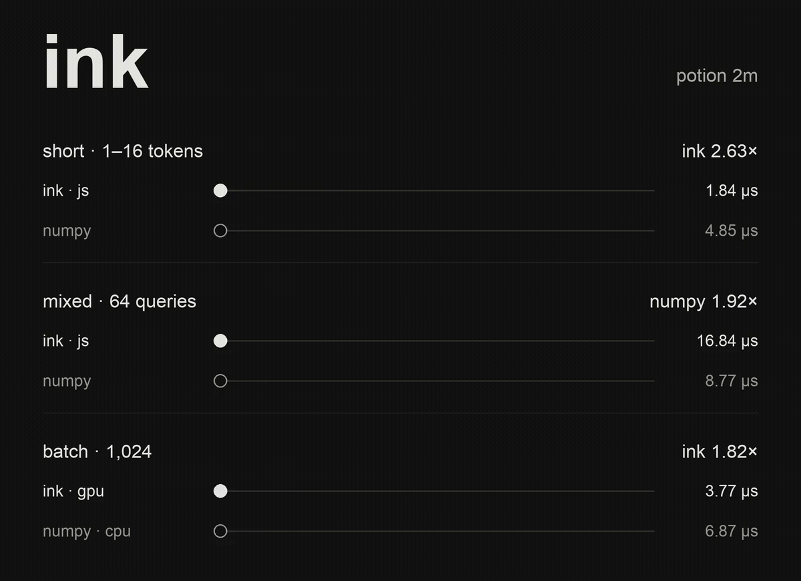
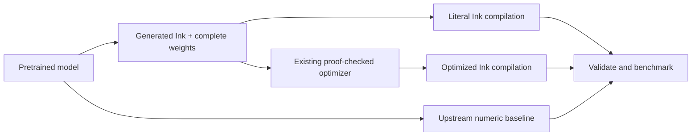

# Ink Static Embeddings

Compile static embedding inference written in Ink to JavaScript, Rust and
WebGPU, using existing learned weight tables as data. Model adapters read
metadata and emit the supported lookup/pooling/normalization pipeline; they do
not translate arbitrary library source code. The tokenizer remains host-side.
This is an architecture-aware importer, not a decompiler that recovers algorithms
or concepts from learned weights.

The supported architecture is **static token embeddings with mean pooling and
optional L2 normalization**. The importer reads model metadata and weights;
there is no model-name allowlist. It supports Model2Vec and Sentence Transformers
StaticEmbedding exports. Tokenization stays host-side; generated numeric
inference runs independently of the original library. Transformer/LLM import and
discovery of hidden symbolic algorithms are future work.

Potion 2M and 8M are Model2Vec models. Sentence Transformers compatibility covers
its `StaticEmbedding` module with optional `Normalize`, rather than its
transformer-based models.

## Tested models

**Three pretrained models and two synthetic fixtures** have passed JavaScript,
native Rust, browser Rust/Wasm and hardware WebGPU correctness checks:

| Pretrained model | Dimensions | F32 table values | Correctness | Performance data |
| --- | ---: | ---: | --- | --- |
| [minishlab/potion-base-2M](https://huggingface.co/minishlab/potion-base-2M) | 64 | 1,889,792 | JS / Rust / Wasm / WebGPU | [JS CPU](results/javascript/REPORT.md), [Rust CPU](results/compiler/REPORT.md), [Rust/Wasm](results/wasm/REPORT.md), [native GPU](results/targets/REPORT.md), [browser WebGPU](results/browser/REPORT.md) |
| [minishlab/potion-base-8M](https://huggingface.co/minishlab/potion-base-8M) | 256 | 7,559,168 | JS / Rust / Wasm / WebGPU | Not benchmarked |
| [sentence-transformers/static-retrieval-mrl-en-v1](https://huggingface.co/sentence-transformers/static-retrieval-mrl-en-v1) | 1,024 | 31,254,528 | JS / Rust / Wasm / WebGPU | Not benchmarked |

The synthetic fixtures cover weighted/remapped 7-dimensional embeddings and
5-dimensional embeddings with clamped normalization. They are test data, not
pretrained models. See [all tested models, pinned revisions and evidence](TESTED_MODELS.md)
and the [general architecture validation](results/general/REPORT.md).

Performance claims currently apply **only to Potion 2M**. Correctness results for
the other models do not establish their speed or embedding quality.

## Results

The latest [packed-row JavaScript study](results/javascript-rows/REPORT.md)
reduces mixed-corpus public-API latency from **17.34 to 9.90 µs/query (1.75×)**;
long inputs improve from **50.96 to 25.77 µs (1.98×)**. Short-input latency stays
roughly unchanged at **2.09 µs**, versus **4.93 µs for NumPy (2.35× faster)**.
NumPy still wins on the mixed corpus: **8.72 versus 9.90 µs**; the new JS path
takes about 13% longer.
The new JS path also improves **1.80× in installed Chrome**, and all five
models/fixtures pass its browser correctness checks. Only Potion 2M has timing
data. Sources, controls, setup costs and adverse results are retained.

The row layout is an explicit option. Its authored Ink selects a token row once,
then visits adjacent dimensions using a dense F32 accumulation buffer. The
compiler improvement is generic Buffer execution support; this is not a newly
discovered/equality-selected algorithm. See [how to build and load it](#packed-row-javascript).

The [general typed GPU boundary study](results/generalization/gpu-boundary/REPORT.md)
improves batch-1,024 throughput from **3.50 to 1.70 µs/embedding (2.06×)** using
the same Ink source and byte-identical shaders. This compiler/runtime improvement
copies exact output words into a fresh typed result, avoiding intermediate
Number arrays. Batch-one latency is unchanged. The public GPU loader uses this
path when targets are rebuilt with the current pinned compiler; older bundles
retain the ordinary-read fallback. All five models pass actual-loader hardware
checks. This is a GPU-versus-GPU comparison, separate from the NumPy studies.

The broader [generalization work](results/generalization/progress.json) remains
in progress. Frozen matrix-column, feedback-filter and channel-energy programs
show **3.03× / 8.03× / 2.48× Rust gains** from the existing checked independent-fold
law, while JavaScript regresses. A new generic Buffer law is checked but has no
additional robust gain and is retained only as an experimental candidate.
Ordinary planner acquisition found a 2.63× calibration gain but correctly
retained the baseline when a smaller independent holdout failed its uncertainty
and minimum-gain guard. These observations do not install an unconditional policy.

The [callback-lifetime follow-up](results/generalization/method-loans/REPORT.md)
adds a general Ink ownership-analysis improvement. The guarded Rust matrix
candidate improves **1.34×** (3.43 to 2.56 µs), while its literal/unconditional
controls and both held-out workloads remain essentially unchanged. All 11
JavaScript outputs are byte-identical. The checked source algorithms and planner
policy are unchanged; this gain is not an embedding benchmark result.

The [resident-composition study](results/generalization/resident/REPORT.md)
compares typed CPU round-tripping with the new general browser
`session.writeFrom(...)` API. Keeping intermediates on-device improves three
unrelated producer/consumer pipelines by **1.28–1.71×**, with exact complete
results. Potion embedding -> similarity improves **1.29×** at 16 queries x 256
documents (62.50 to 48.44 µs/query); the existing combined-session control takes
40.63 µs/query. These are warm pipeline comparisons, not NumPy comparisons.
[Setup and corpus preparation costs](results/generalization/resident/LIFECYCLE.md)
are retained separately. The GPU/runtime mechanism is published in the pinned
Ink distribution; it grants no automatic placement policy.

The [experimental GPU adapter](results/gpu-fusion/REPORT.md) takes the previous
browser GPU path from **3.61 to 1.30 µs/embedding (2.77×)** at batch 1,024 with
strict arithmetic, or **0.82 µs (4.39×)** using opt-in native float. These are
median results from three fresh Chrome processes; timings vary substantially
between processes. Most of the strict gain is already present in the adapter's
three-dispatch control: fusion adds only about 1% at this batch size. Host/ABI
and shader-emission differences remain bundled; both paths already reuse device
and readback staging buffers. This adapter generates authored WGSL
schedules; it is **not an Ink compiler optimization**. Native float changes
some top-k results despite small embedding errors. See [usage and contracts](#experimental-gpu-schedules).

**Earlier study: faster for short CPU queries and large GPU batches; slower for
the mixed CPU corpus.** All measured performance results use Potion 2M on an
Apple M4 Pro. Loading and tokenization are excluded.

| Measurement | Ink | Original NumPy CPU | Result |
| --- | ---: | ---: | --- |
| [JS CPU, 1–16 tokens](results/javascript/REPORT.md) | 1.84 µs/query | 4.85 µs/query | **2.63× faster** |
| [JS CPU, mixed 64-case corpus](results/javascript/REPORT.md) | 16.84 µs/query | 8.77 µs/query | **1.92× slower** |
| [Native GPU, batch 1,024](results/targets/REPORT.md) | 3.77 µs/embedding | 6.87 µs/embedding | **1.82× CPU throughput** |
| [Browser WebGPU, batch 1,024](results/browser/REPORT.md) | 4.10 µs/embedding | 6.87 µs/embedding | **1.68× CPU throughput** |

CPU rows are single-query latency. GPU rows are amortized batch throughput with
resident weights, new-query uploads and complete readback; **no upstream GPU
baseline has been measured**. The browser comparison uses a separately measured
CPU baseline. The latest JS changes improve the previous checked JS compilation
by 1.31× on short inputs and 1.05× on the mixed corpus; one-time weight preparation
increases from 17.56 to 29.05 ms. Every output still matches the ordered F32 oracle
bit for bit. See the linked reports for raw samples and measurement boundaries.



[Download the animation as GIF or MP4](media/README.md). Its CPU panels retain the
earlier direct-destination study; the latest row-layout measurements above use
the public API with freshly allocated, detached results.

The [Rust/Wasm browser experiment](results/wasm/REPORT.md) compares CPU paths in
the same Chrome session: optimized JS **22.43 µs/query**, unchanged Ink → Rust/Wasm
**11.55 µs**, and an authored four-dimension Ink layout → Rust/Wasm **9.29 µs**
over the mixed corpus. The latter is **2.41× faster than optimized JS**. Weights
stay resident in Wasm; this is a different benchmark from the Node/NumPy table
above. SIMD division is present; pooling additions remain scalar. The four-lane
layout is authored source, not a newly discovered compiler rewrite.

**Initial result:** conversion and fidelity checks pass, but this workload shows
no clear compiler-optimization speedup. The original NumPy kernel is faster than
the compiled JavaScript implementation. The later [Rust/GPU experiment](results/targets/REPORT.md)
finds a throughput benefit from large GPU batches, against a CPU baseline.
See [the initial measured report](results/REPORT.md)
and [raw evidence](results/report.json). Adverse results are part of the experiment.

The [checked compiler follow-up](results/compiler/REPORT.md) makes the existing
ordered pooling fusion reachable and fixes its structural search price. The same
unchanged model source now runs **1.70× faster in JavaScript** than the prior
checked result (32.18 → 18.94 µs/embedding). Rust with a checked borrowed
entrypoint averages 10.97 µs over the same mixed corpus. Both CPU results remain
slower than the historical NumPy 8.51 µs baseline. These are CPU improvements;
GPU gains are recorded separately.



## Import and run a static model

Requirements: Python 3.12+, uv, Node 22+, the pinned Ink toolchain and Rust/Cargo
on PATH for the Rust and WebGPU builds. Bootstrap the toolchain as described
below. The default CLI emits schema 2 metadata and a complete F32 table:

```sh
uv sync --dev
# With the distribution at toolchain.lock.json, built using cargo build --release --locked:
uv run python scripts/bootstrap_toolchain.py /absolute/path/to/ink-lang
uv run ink-static-embeddings /path/to/model build/my-model --model-id OWNER/MODEL --revision COMMIT
uv run python scripts/build_model.py --build build/my-model --toolchain work/toolchain
# Add --optimize to also run the existing proof-checked JavaScript optimizer.
```

Use `--format model2vec` or `--format sentence-transformers` to override format
detection. `--targets javascript,rust,webgpu` selects targets; its default builds
all three. This generates a literal JS module, a Rust crate with `native_batch`,
and a browser/native WebGPU bundle. Rust can be compiled with ordinary Cargo.

The importer derives dimensions, vocabulary and the number of JavaScript weight
shards from metadata. Shards stay below Ink's capture-node limit. Rust uses an
owned flat buffer within a pure batch call; WebGPU uses a resident flat table.
Neither target depends on a Potion-specific split or dimension count.

Model2Vec exports may include F32 per-token weights and vocabulary mappings.
These are materialized into the effective lookup table, preserving F32 row
multiplication before pooling. Source file hashes and this expansion are recorded.
Normalization is preserved: Model2Vec uses norm plus epsilon, while the optional
Sentence Transformers Normalize module clamps the norm. Raw means are supported
too. Unknown-token filtering follows the source format.

For browser numeric inference, serve the model directory and this repo's host
module over HTTP(S), then use pretokenized IDs from the original tokenizer:

```js
import {loadStaticEmbedding} from '/runtime/static-embedding.mjs';
const model = await loadStaticEmbedding('/build/my-model/', {backend: 'gpu'});
const session = await model.createSession({batchSize: 2, tokenCapacity: 32});
const embeddings = await session.encodeBatch([[1, 2, 3], [4, 5]]);
await session.close();
await model.close();
```

IDs in this example must exist in the imported vocabulary. A session keeps weights
resident and accepts changing queries within its declared capacities. JavaScript
uses `loadStaticEmbedding(base, {backend: 'javascript'})` and `encodeBatch(queries)`;
Node can use the exported `createJavascriptEncoder` with a generated module,
manifest and F32 table. Encoders return flat F32 embeddings in document order.
Inputs outside the vocabulary or session limits fail rather than being truncated.

Current boundaries: finite F32 tables, 1..4096 dimensions, mean pooling, and optional
supported normalization. Integer/packed quantized tables, extra Dense/attention
layers and other pooling operations are rejected. GPU limits remain Ink's existing
256 MiB live-allocation budget plus the actual device limits. Larger models can
be imported for CPU targets without fitting the GPU budget; vocabulary expansion
may increase their effective table size. GPU sessions default to at most 4096
tokens per document; `build_model.py --max-tokens N` changes the explicit bound.

## Typed input preparation

The shared Ink ABI/runtime also has a separate
[typed-input transport study](results/generalization/typed-input/REPORT.md).
Public Potion 2M batch-16 ready-session setup fell from **27.6 ms to 4.4 ms
(6.27×)** through direct validated typed-float transport. This is an Ink runtime
setup benefit, not a 7× embedding inference claim. Warm inference showed no
established comparable gain; the report retains small-input regressions and
unchanged mixed-record controls alongside the gains.

## Packed-row JavaScript

After importing a schema-2 model, build the optional readable row layout using
the current pinned compiler (bootstrap it into a new directory with
`--output work/row-toolchain`):

```sh
uv run python scripts/build_js_rows.py --build build/my-model --compiler work/row-toolchain/ink
```

This emits `javascript/packed-rows/model.ink`, its compiled `model.mjs`, and a
layout receipt. Existing weight files and token IDs stay unchanged. The host
captures typed rows once; no learned weights are converted into source literals.

```js
import {loadStaticEmbedding} from '/runtime/static-embedding.mjs';
const model = await loadStaticEmbedding('/build/my-model/', {
  backend: 'javascript',
  javascriptLayout: 'packed-rows',
});
const embeddings = model.encodeBatch([[1, 2, 3], [4, 5]]);
```

Node can import the generated module and call
`createJavascriptEncoder(module, manifest, weights, {layout})`, where `layout`
is the emitted receipt. The reference layout remains available through the
existing default API. The packed source prefetches row references for up to 16
tokens and uses row-oriented accumulation for longer inputs. Every dimension
retains token-sum order and the norm retains its right fold.

The compiler uses dense private Number storage for native F32 Buffer fill;
exact NaN tags retain ordinary slots, tagged writes promote only their owner's
range, and growth/freezing preserve source List semantics. Map traversal caches
the private range and refreshes it on promotion. It does not infer finite values,
reassociate arithmetic or grant ownership to shared inputs. The public output
bridge also preserves infinity/NaN bit carriers in Float32Array results.

The [Node/NumPy report](results/javascript-rows/REPORT.md) separates the authored
layout, compiler storage changes, and public output-boundary control. In
[Chrome](results/javascript-rows/browser/REPORT.md), the source layout delivers
most of the gain: old array storage nearly ties dense storage overall, and is
faster for the medium bucket. This is not a universal storage-policy win.
Row packing also allocates one captured typed array per vocabulary row; its
setup/memory cost can outweigh inference gains for short-lived models.

Both JS storage implementations use the identical row Ink source. All 64
measured outputs and all five retained model/fixture suites match the independent
ordered F32 oracle bit for bit. Additional 1/7/17-dimensional integration cases
exercise overflow, subnormals, signed zero, infinities and NaNs. See the
[retained sources and targets](artifacts/javascript-rows),
[validation receipt](results/javascript-rows/validation.json), and
[compiler receipt](results/javascript-rows/toolchain.json).

```sh
uv run python scripts/js_rows_benchmark.py
PLAYWRIGHT_MODULE=../work/browser-tools/node_modules/playwright/index.mjs node scripts/js_rows_browser.mjs
```

These reproduction harnesses use the retained Potion 2M corpus and build paths;
the model importer, row generator and loader use metadata rather than model names.

## Experimental GPU schedules

After building a model's existing WebGPU target, generate the optional schedules:

```sh
uv run python scripts/build_gpu_fusion.py --build build/my-model
```

This writes `gpu-experimental/` shader files and hash receipts. The generator
uses model dimensions and normalization metadata, with unchanged learned weights.
Its strict shaders reuse the pinned Ink-emitted integer arithmetic helpers.
The workgroup fusion, flat host ABI and search kernels are authored here; they
have not been added to Ink's lowering or admitted as compiler rewrites. The
existing `gpuKernel: 'ink'` default remains the compiled Ink path.

```js
const model = await loadStaticEmbedding('/build/my-model/', {
  backend: 'gpu', device,
  gpuKernel: 'fused-strict', // 'fused-native' explicitly selects approximate math
});
const queries = await model.createSession({batchSize: 2, tokenCapacity: 32});
const corpus = await model.createSession({batchSize: 3, tokenCapacity: 32});
const corpusEmbeddings = await corpus.encodeBatchResident([[1, 2], [3, 4], [5]]);
const queryEmbeddings = await queries.encodeBatchResident([[1, 3], [5]]);
const matches = await queryEmbeddings.search(corpusEmbeddings, {k: 2});
// Flat, detached matches.indices / matches.scores; no embedding readback.
const embeddings = await queryEmbeddings.read(); // optional complete download
await model.close(); // waits for queued operations and releases all sessions
```

Supply a WebGPU device with sufficient storage binding/buffer and workgroup
storage limits for the model. Resident leases expire when their session encodes
again or closes. Sessions on one model serialize operations; search requires
both leases to belong to that model. `encodeBatch()` remains available for a
complete fresh `Float32Array`. No fallback is performed by this experimental
adapter. The 256 MiB allocation budget and actual device limits are enforced.

Search computes a dense dot-product score matrix followed by top-k selection
(`1 <= k <= min(32, corpus size)`); it is a bounded brute-force path, not an ANN
index. Equal scores retain the lower document index; NaNs sort last. Unnormalized
models use dot product, not cosine similarity. `gpuSchedule: 'split'` exposes the
matched three-dispatch benchmark control.

Strict mode passed bit-exact checks on all five models/fixtures and four extra
edge shapes, including overflow, subnormals and 4,096-token documents. Native
mode uses approximate WGSL float arithmetic, with finite-intermediate weight and
epsilon bounds. On the five validation suites it passed `atol=2e-6, rtol=2e-5`,
but this is not a guarantee for unseen queries/devices. The small resident search
fixture has **95% native top-10 ID agreement**, versus 100% strict, against ordered
F32 dot products of the same embeddings. This is numerical ranking agreement,
not a semantic retrieval-quality benchmark.

The [full report](results/gpu-fusion/REPORT.md) includes process ranges, adverse
fusion results, readback costs, resident-search controls and reproduction commands.
Pretrained weights remain external data; [measured shaders and receipts](artifacts/gpu-fusion)
are retained. Only Potion 2M has timing data.

To reproduce the validation matrix (PyTorch is only a validation dependency):

```sh
uv sync --dev --group validation
uv run python scripts/prepare_validation_models.py
# For each NAME: potion-2m, potion-8m, st-retrieval, unseen-weighted, unseen-clamp
uv run python scripts/build_model.py --build build/general/NAME
uv run --group validation python scripts/validate_model.py --model-dir work/models/NAME --build build/general/NAME --rust
npm install --prefix work/browser-tools playwright@1.58.2 --no-audit --no-fund
PLAYWRIGHT_MODULE=../work/browser-tools/node_modules/playwright/index.mjs node scripts/validate_browser.mjs build/general/NAME
INK="$PWD/work/toolchain/ink" uv run pytest -q
```

The general validation checks original Model2Vec inference or PyTorch's actual
StaticEmbedding operations with tolerance, then demands bit-exact agreement with
the independent ordered F32 oracle across generated JavaScript, Rust and hardware
WebGPU. These checks establish tested compatibility, not a universal proof for all
possible models or a new performance claim.

## Historical Potion 2M experiment

The sections below retain the original schema 1 benchmark and its reproduction
scripts. `prepare_model.py` explicitly selects that historical importer. Its
measured results do not apply automatically to other models or the new layouts.
Use `toolchain.legacy.lock.json` for this historical reproduction.

## What is converted

`src/ink_static_embeddings/converter.py` reads the model's config and safetensors.
It emits [readable Ink](generated/model.ink), a little-endian F32 weight asset,
and a [hash/shape manifest](generated/model.json). All numeric inference runs
inside the generated Ink program; there is no Python model call inside Ink.
The original pinned tokenizer remains a host-side dependency and is identical
across comparisons. Inputs are valid tokenizer IDs in the model's vocabulary.
No model training, vocabulary reduction or dimensional truncation is performed.

The complete weight table is captured once through Ink's existing sealed-value
interfaces. Two argument shards keep each capture within its existing one-million
node bound. A normal bounded Ink loop constructs the coordinate list, avoiding
an existing planner nesting limit for long literal lists. Neither mechanism
changes Ink or its limits. Unsupported architectures/shapes fail explicitly.

The importer defines explicit source-order binary32 arithmetic. Pooling is a
left fold; the norm's squared terms use a right fold. NumPy uses its own reduction
strategy, so equivalence to the original model is checked with stated tolerance,
not claimed bitwise. Literal and optimized Ink outputs must match bitwise,
and both must match a separate ordered F32 oracle bitwise. This importer is an
architecture translation, not a mechanistic decompiler.

## Reproduce

Requirements: Python 3.12+, uv, Node 22+, and the pinned Ink distribution.
Rust/Cargo are needed only when building that compiler yourself.

```sh
uv sync --dev
uv run python scripts/prepare_model.py
# Start from a recursive ink-lang checkout at toolchain.legacy.lock.json's revision.
# Build it normally with cargo build --release --locked, without source patches.
uv run python scripts/bootstrap_toolchain.py /absolute/path/to/ink-lang --lock toolchain.legacy.lock.json
uv run python scripts/build.py --toolchain work/toolchain
INK="$PWD/work/toolchain/ink" uv run pytest -q
uv run python scripts/benchmark.py --processes 6 --rounds 9
```

Bootstrap copies only committed planner/knowledge tool bytes and the existing
compiler into a private directory. It verifies pinned package revisions.
The compiler's standard modules are embedded; the initial experiment uses its
JavaScript target. A small vendored selection of existing Ink laws is published into
the experiment's private catalogue. Existing untrusted producers may propose
additional laws, and the unchanged compiler checks every selected application.
No installed/global knowledge database is written. The retained selection fuses
the norm's map into its ordered reduction; it does not change floating-point
grouping. The source-order pooling loop currently remains unchanged.

The historical importer supports normalized, unquantized two-shard Model2Vec.
The default CLI now uses the generalized schema 2 importer described above.

## Reproduce the compiler follow-up

Keep the historical `build/` fixture and compiler available, and supply a checkout
with the current pinned planner/knowledge packages. Rust/Cargo must be on PATH.

```sh
uv run python scripts/compiler_improvements.py --ink-checkout /absolute/path/to/current/ink-lang
```

This offers existing polymorphic pipeline laws, replays the selected equality
proofs, and replays a source-bound read-only physical plan. It times the original
model source, with no handwritten replacement kernel. Rust's generated
`ink_borrowed_function_l_encode` borrows weights and IDs; the owning entrypoint
remains available. A borrowed call evaluates new inputs afresh and returns owned
output. The report separates this boundary choice from the semantic fusion.
All 64 complete outputs match the ordered F32 oracle bit for bit.

Current general builds with `--optimize` use `knowledge/static-pipelines.json`;
historical builds retain `knowledge/laws.json`. The compiler/planner/knowledge
revision pins are explicit, and original reports keep their original identities.

### Reproduce the current JavaScript latency study

With the historical `build/` model and corpus prepared above, the exact measured
before/after JavaScript modules are retained in `artifacts/javascript/`:

```sh
uv run python scripts/js_latency_benchmark.py \
  --before artifacts/javascript/before.mjs --after artifacts/javascript/after.mjs \
  --output work/repeated-js-latency
```

To regenerate the current module, build the distribution at `toolchain.lock.json`
and run its `ink build build/model.ink --selection results/compiler/selection.json
--target javascript -o build/js-dense-inline.mjs`. The retained checked selection
is unchanged. [Compiler/artifact identities](results/javascript/toolchain.json)
and [five-model JS regression results](results/javascript/compatibility.json)
are recorded separately from the performance samples.

## Measurement boundaries

Three warm numeric paths receive the **same token IDs** and return complete
64-dimensional embeddings: upstream Model2Vec/NumPy, literal Ink/Node, and
checked-optimized Ink/Node. Weight capture is paid once per fresh process.
The compiler comparison uses identical runtime, corpus and call boundaries.
Python/NumPy versus JavaScript is an implementation comparison, not an isolated
compiler effect. This initial report covers CPU JavaScript; the follow-up below
measures native Rust and actual GPU execution separately.

Six process groups alternate execution order. Each process warms three complete
corpus passes, then records nine passes over 64 cases. Cases include empty and
Unicode text, repeated tokens, text truncated at 512 tokens and seeded IDs from
the full vocabulary. Timed calls receive changing queries; only weights are
bound, so whole predictions cannot be retained between calls. Every output is
consumed. All raw outputs and timings are retained, not just the fastest sample.

The harness also records full-library text-batch timings, setup/import/capture,
process peak RSS, compilation/search time and artifact sizes. Full-library text
timings include tokenization and are not compared directly with numeric-only
Ink timing. Correctness checking is separate from timed passes. Twelve distinct
text fixtures additionally check nearest-neighbor ranking preservation; this is
not an embedding-quality benchmark such as MTEB.

`artifacts/` retains the core, generated target modules and portable selection.
`results/` binds their compiler/source identities and records harness hashes.
Model weights are redownloaded from an immutable revision and hash-checked.
No credentials or model caches are committed.

## Historical boundaries and follow-up

This experiment establishes a full small-model conversion and checked optimization
attempt. It does not demonstrate a speedup, general network import, neural
architecture discovery, or a universal proof of the compiler/importer.
The later compiler follow-up makes existing checked ordered-pooling fusion
reachable, and the current short-input JS result is recorded above. Wider
operator coverage remains future work. Ink remains an independently pinned dependency.

## Native Rust and GPU follow-up

The first benchmark was entirely CPU: upstream NumPy versus compiled Node.js.
The [follow-up report](results/targets/REPORT.md) adds native Rust and the actual
Apple M4 Pro GPU through Metal. It requires `gpu-required`, checks a physical
adapter, and validates every returned embedding against the independent F32 oracle.
There is **no upstream GPU baseline** here. A CPU-to-GPU gain does not establish
that Ink outperforms another GPU implementation of the model.

Target preparation is explicit source-level importer work, not a new optimizer
law or compiler modification. A balanced constant coordinate list avoids the
original GPU fallback. Three batch entrypoints expose independent pooling,
normalization and output coordinates to the GPU. Native variants use existing
owned buffers within one pure invocation to avoid cloning the complete weight
table at every helper call. The original helper-heavy native probe and a slower
row-oriented variant are retained rather than omitted.

Rust/Cargo must be on PATH, alongside the requirements above:

```sh
uv run python scripts/build_targets.py --toolchain work/toolchain
uv run python scripts/target_benchmark.py --processes 3
```

Native timings include model copy-in once per batch through its current typed
API. GPU timings keep weights resident and include upload of new query data,
three completed dispatches, readback and decoded output. Session open/model upload
is separate and recorded. Large-batch per-embedding values describe amortized
throughput, not individual request latency. The GPU still loses on small batches.
The supplied shaders preserve Ink's strict ordered binary32 contract using
integer-lane arithmetic; they are not ML-specific fast-math kernels.

## Browser WebGPU

The [browser report](results/browser/REPORT.md) measures installed, visible Chrome
with three fresh browser process groups on the same Mac. The unchanged compiler's
browser runtime executes the same three GPU stages with resident weights.
Every output in every measured round matches the ordered F32 oracle bit for bit.
CPU fallback is forbidden. A warm single request takes about 0.71 ms; a batch of
1,024 takes about 4.20 ms total, or 4.10 µs per embedding. These are numeric
inference timings: input uploads, completed GPU work and complete decoded
readback are included; tokenization, model download and startup are excluded.

After building the targets above, install the benchmark-only browser dependency
in the ignored work directory and use an installed Google Chrome:

```sh
npm install --prefix work/browser-tools playwright@1.58.2 --no-audit --no-fund
PLAYWRIGHT_MODULE=../work/browser-tools/node_modules/playwright/index.mjs node scripts/browser_benchmark.mjs
```

The harness serves only on loopback, uses isolated browser profiles, checks for a
hardware adapter and closes its browsers/server afterwards. The retained report
includes the browser version, GPU adapter information, startup costs, raw round
timings and output hashes. No upstream browser GPU implementation is benchmarked.

## Rust in the browser

The experimental Wasm host compiles the original generated Ink plus an optional
four-dimension `Vec4<f32>` variant through Ink's existing Rust backend and a
checked read-only parameter plan. Rust is then compiled to `wasm32-unknown-unknown`
with `simd128` enabled. It uses no wasm-bindgen model-copy adapter and requires
no Ink compiler changes.

Weights cross into Wasm once, are split into resident Rust vectors once, and are
borrowed for each inference call. Changing IDs cross in and a complete detached
embedding crosses out. Initialization, loading and preparation are recorded
outside the warm inference measurements. Temporary loading storage is freed
after splitting; linear memory retains its high-water allocation.

```sh
rustup target add wasm32-unknown-unknown
uv run python scripts/build_wasm.py --build build/general/potion-2m --toolchain work/js-toolchain
```

`work/js-toolchain` is a private compiler copy bootstrapped at `toolchain.lock.json`;
use `--output work/js-toolchain` when running `bootstrap_toolchain.py`. Repeat the
Wasm build command for any schema-2 import. All five compatibility models/fixtures
were built and checked in installed Chrome. Source, binary and checked-plan
artifacts are retained in [artifacts/wasm](artifacts/wasm), with the
[validation matrix](results/wasm/validation.json).

Serve the repository over HTTP(S) and call it with tokenizer IDs:

```js
import {loadWasmStaticEmbedding} from '/runtime/static-embedding-wasm.mjs';
const model = await loadWasmStaticEmbedding('/build/general/potion-2m/', {
  variant: 'ink-quads', // 'ink' runs the original generated source layout
  maxTokens: 4096,
});
const embedding = model.encode([1, 2, 3]);
model.close();
```

The adapter also exposes `encodeInto(ids, destination)` and `encodeBatch(queries)`.
Batch currently loops over per-document Wasm calls; it is not a fused Rust batch.
Invalid IDs, over-capacity inputs, incompatible modules and calls after close
reject. Unsupported SIMD engines fail at module instantiation.

To repeat the retained browser benchmark, first prepare all five Wasm builds and
the optimized Potion 2M JS build, then run:

```sh
uv run python scripts/build.py --build build/general/potion-2m --toolchain work/js-toolchain --catalogue knowledge/static-pipelines.json
PLAYWRIGHT_MODULE=../work/browser-tools/node_modules/playwright/index.mjs node scripts/wasm_browser_benchmark.mjs
```

Six fresh headed Chrome processes compare public APIs with identical IDs and
complete output consumption. All 64 benchmark outputs and both Wasm variants on
all five compatibility fixtures match the ordered F32 oracle bit for bit.
The [instruction inspection](results/wasm/instructions.json) records actual
`f32x4.div` instructions and **zero `f32x4.add` instructions**. SIMD enabled at
compile time does not establish SIMD pooling or attribute the speedup to SIMD.
The original literal-JS probe remains in [results/wasm/literal-probe](results/wasm/literal-probe);
the headline comparison uses checked-optimized JavaScript.

MIT. Model and dependency provenance: [THIRD_PARTY.md](THIRD_PARTY.md).
