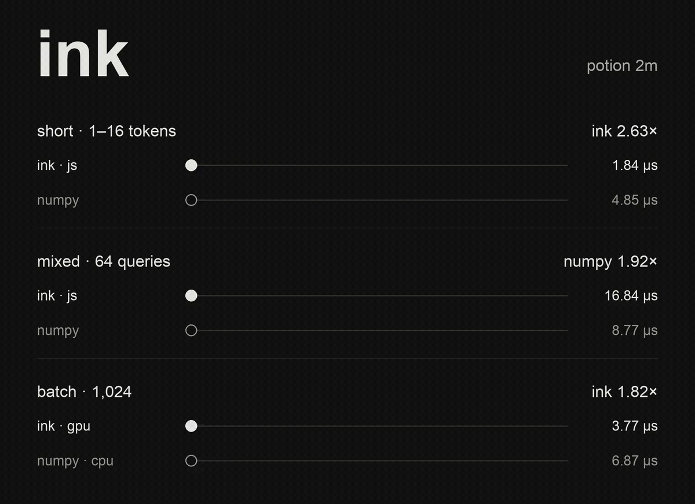

# Shareable CPU speed comparison

[GIF](potion-2m-speed.gif) · [MP4](potion-2m-speed.mp4) · [Static PNG](potion-2m-speed.png)



The 10-second animation compares current Ink-generated JavaScript with original
Model2Vec/NumPy numeric inference for **Potion 2M on an Apple M4 Pro CPU**:

| Workload | Ink / JS | Model2Vec / NumPy | Result |
| --- | ---: | ---: | --- |
| Short, 1–16 tokens | 1.84 µs/query | 4.85 µs/query | Ink 2.63× faster |
| Mixed 64-case corpus | 16.84 µs/query | 8.77 µs/query | NumPy 1.92× faster |

Ball velocity is proportional to inverse measured latency, with a common track
distance and scale across both panels. Movement is slowed for viewing; it is not
real-time execution. Balls fade at the loop boundary, preserving the measured
ratios without forcing an integer number of trips. Empty inputs are excluded
from the short group and included in the mixed corpus.

These are single-query CPU results. Loading/tokenization are excluded; changing
ID capture and complete output consumption are included. Same weights and IDs;
the generated path reuses a caller destination while NumPy allocates its normal
result. Raw timing samples, setup costs and checks are in the
[CPU latency report](../results/javascript/REPORT.md). No other model or GPU
comparison is represented by this graphic.

To regenerate from the recorded JSON data (Pillow and ffmpeg required):

```sh
uv run --no-project --with pillow python scripts/render_speed_animation.py
```

The default font path uses macOS Arial; `--font-dir` accepts another directory
containing `Arial.ttf` and `Arial Bold.ttf`. Font files are not included.

Suggested post:

> I ported static embedding inference to Ink and built tooling to load existing model weights and compile the inference code to JS, Rust & WebGPU.
>
> On Potion 2M, JS beats NumPy by 2.6× for short inputs. NumPy wins on longer ones.
>
> Code + benchmarks: [github.com/siliconjungle/ink-static-embeddings](https://github.com/siliconjungle/ink-static-embeddings)
